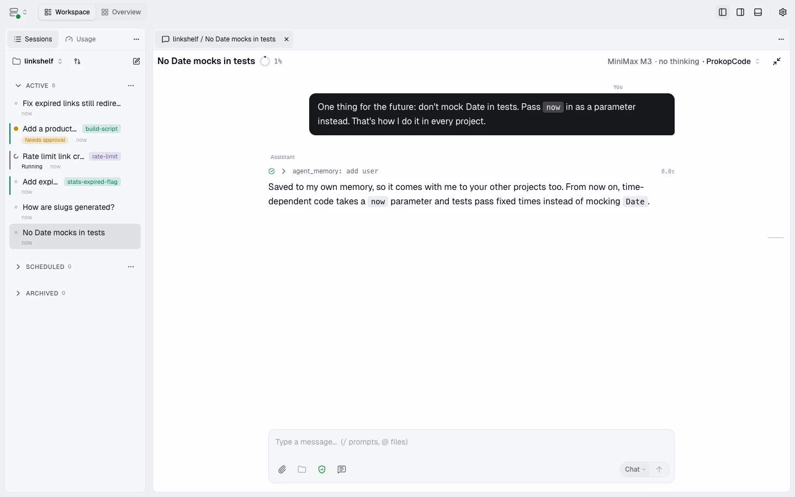
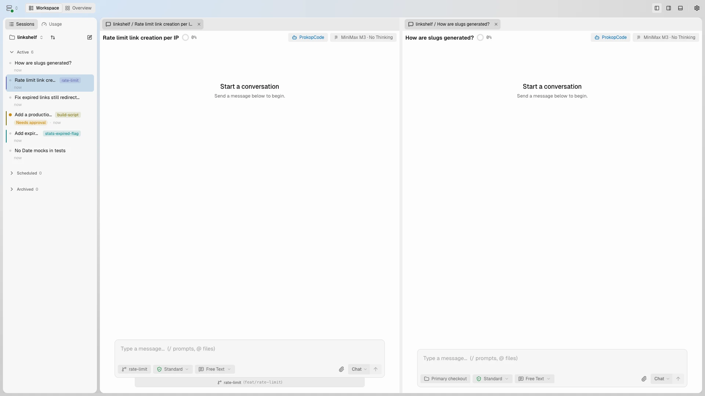
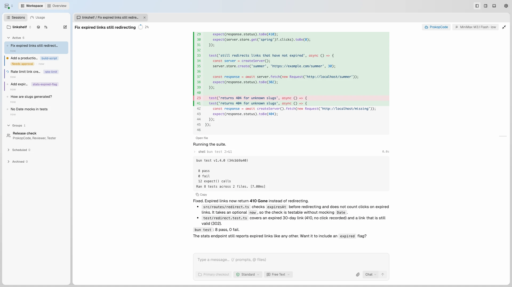
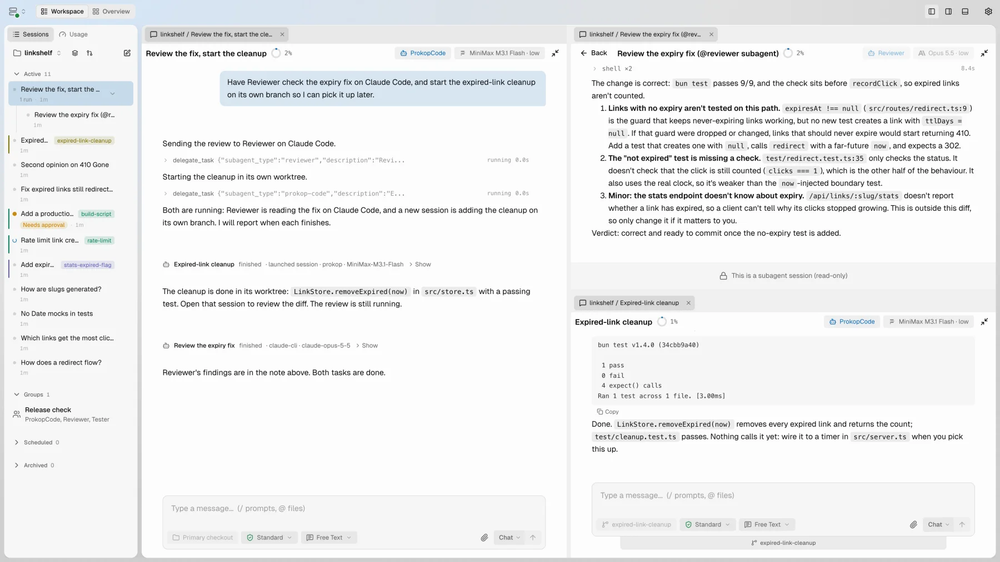
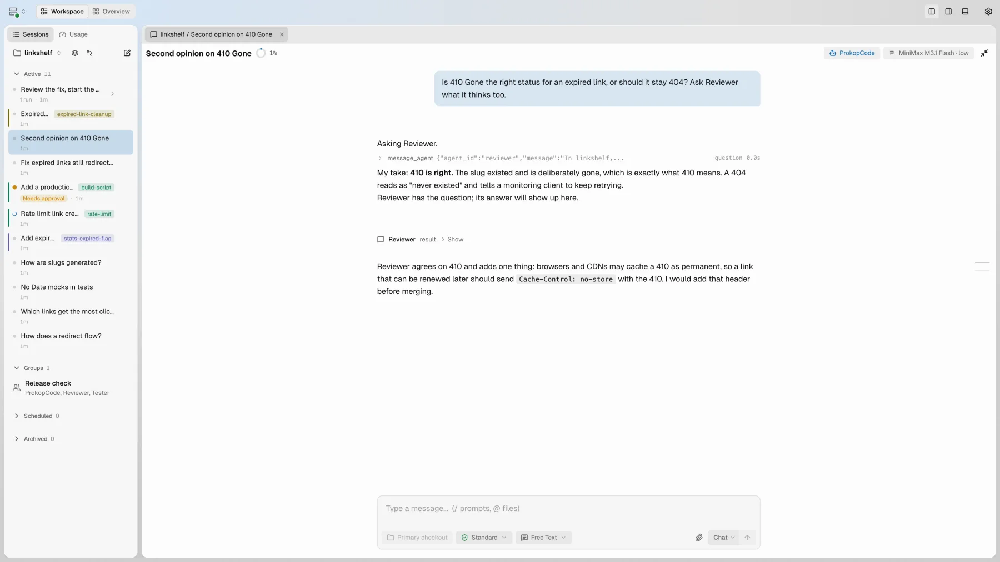
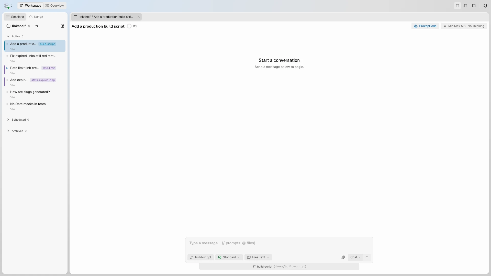
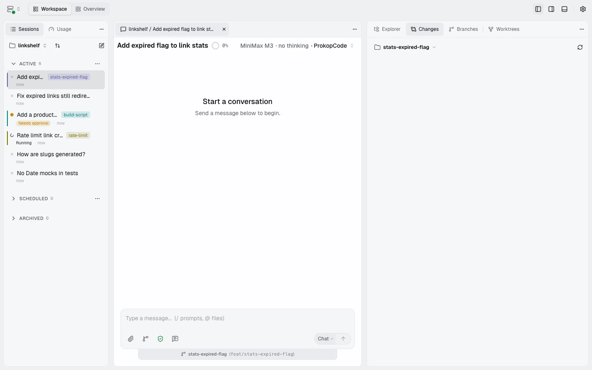
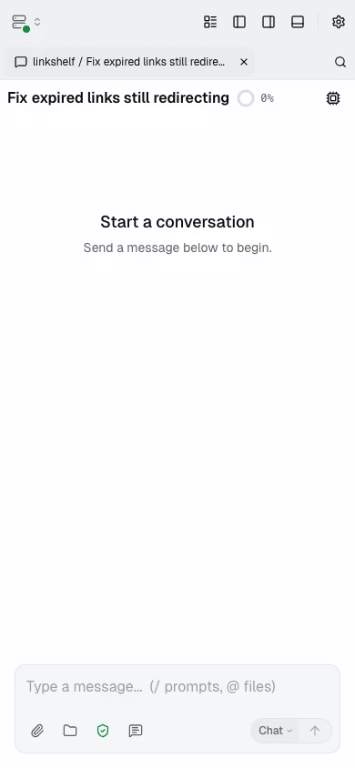
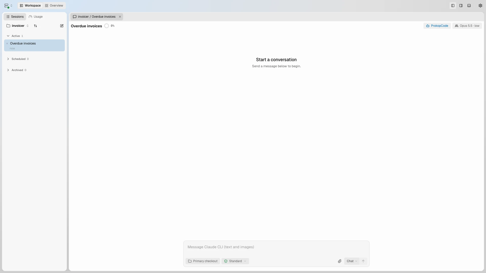

<p align="center">
  <picture>
    <source media="(prefers-color-scheme: dark)" srcset="docs/readme/memory-dark.webp">
    
  </picture>
</p>

<h1 align="center">Coding agents that get to know you.</h1>

<p align="center">
  Prokop is an open-source coding workspace where your agents keep their own memory and skills, search their earlier sessions, and learn from finished work. You keep working with the same coworker instead of briefing a stranger every session. With Claude Code, Codex, or Prokop's own runtime, on your machine.
</p>

<p align="center">
  <a href="https://github.com/prokopai/prokop/releases"></a>
  <a href="LICENSE"></a>
  <a href="https://bun.sh"></a>
  <a href="https://www.typescriptlang.org/"></a>
</p>

<p align="center">
  <a href="https://prokopai.dev">Website</a> ·
  <a href="https://prokopai.dev/get-started/">Get Started</a> ·
  <a href="https://prokopai.dev/docs">Documentation</a> ·
  <a href="https://github.com/prokopai/prokop/releases">Releases</a>
</p>

---

## Install

```bash
# macOS / Linux
curl -fsSL https://prokopai.dev/install.sh | bash

# Windows PowerShell
irm https://prokopai.dev/install.ps1 | iex
```

Then run `prokop init`. It starts the server and opens the workspace at `http://localhost:8742`. Prokop is one binary: a Bun server with the web client built in, installable as a PWA. Prefer to read the installer first? See the [macOS/Linux](install/install-prokopai.sh) and [PowerShell](install/install-prokopai.ps1) scripts, or grab a binary from [Releases](https://github.com/prokopai/prokop/releases).

## Why Prokop

Your agents build up context over time, and you decide where it lives.

- **Per agent.** Each agent you chat with has its own memory and skills that follow it into every project, so your preferences and ways of working carry over.
- **Per project.** Each workspace keeps its own memory and skills, apart from any one agent. Worktrees of a project share its memory.
- **Across sessions.** Agents search earlier conversations, in the current session, the project, or everything they have worked on, to recall what was decided and why.
- **Over time.** Each agent reviews its finished conversations from any runtime during quiet periods and keeps what is worth keeping in its memory. Turn on workspace learning to keep shared project memory current too, and **Improve skills** to let either refine skills. No prompt to write, no job to schedule. Every review is in a history you can check, and reviews run on the Prokop runtime can be undone change by change. You can turn agent learning off or exclude any project or session.

It is all plain Markdown on disk (`MEMORY.md`, `USER.md`, `SKILL.md`) that you can read and edit, and agents are managed in **Settings → Agents**. Learning edits files, not model weights.

Around that, a complete workspace:

- **Use the agent you already have.** Run Claude Code or Codex CLI on their own logins, or Prokop's built-in runtime on your own provider, in the same workspace.
- **Parallel work without a terminal farm.** Several sessions side by side, each in its own Git worktree if you like, with files, diffs, Git, pull requests, and terminals around them.
- **Several agents on one job.** Put up to ten of your agents in a group chat and address them by name; one hands a stage to the next. An agent can message another agent with a question and get the answer back, or delegate a task to a role on Claude Code, Codex, or Prokop, including sessions that start in their own worktrees.
- **Talk to it mid-turn.** A message you send while the agent works reaches the running turn, and agents can answer with a chart, table, or page right in the reply.
- **Approvals that explain themselves.** Asks name the concrete concern, such as a recursive delete or a path outside the project, and highlight the exact part of the command.
- **The same workspace everywhere.** The full interface on your phone, and sessions from several of your machines in one place.
- **Yours.** Apache 2.0, no account, no telemetry. Local only until you pair another device.

Start plain with one project and one agent, and turn on the rest as you need it.

## See it work

These clips and stills, and the clip at the top, are recorded from a real Prokop instance. Only the model's replies are scripted; every memory write, search, edit, test run, build, and commit actually happens.

**Several sessions at once.** Start a task in one pane and ask a question in another while the first keeps working, each in its own worktree if you like.

<picture>
  <source media="(prefers-color-scheme: dark)" srcset="docs/readme/multi-session-dark.webp">
  
</picture>

**A group chat with your agents.** Reviewer is asked to look over the fix, hands the untested case to Tester, and Tester adds the test and runs the suite. Each member answers from its own session on its own runtime, and the thread shows who said what.

<picture>
  <source media="(prefers-color-scheme: dark)" srcset="docs/readme/group-chat-dark.webp">
  
</picture>

**Delegate across runtimes.** One conversation sends a review to Reviewer on Claude Code and starts the cleanup in a new session on its own worktree. Both results come back as notes, and the child sessions open beside it.

<picture>
  <source media="(prefers-color-scheme: dark)" srcset="docs/readme/delegation-dark.webp">
  
</picture>

**Agents ask each other.** The agent puts a question to Reviewer, which answers from its own home with its own memory, and the answer comes back into the conversation.

<picture>
  <source media="(prefers-color-scheme: dark)" srcset="docs/readme/agent-message-dark.webp">
  
</picture>

**Approvals show what needs review.** Only `rm -rf dist` is highlighted, with the reason beside it. Allow it once and the real build runs.

<picture>
  <source media="(prefers-color-scheme: dark)" srcset="docs/readme/command-approval-dark.webp">
  
</picture>

**Review and commit without leaving the session.** Changes fill in as the agent edits its worktree. Open a file as a diff, pick what to commit, and commit.

<picture>
  <source media="(prefers-color-scheme: dark)" srcset="docs/readme/git-workbench-dark.webp">
  
</picture>

**The whole workspace on your phone.** Same sessions, files, and approvals, served by your machine over networking you choose.

<p align="center">
  <picture>
    <source media="(prefers-color-scheme: dark)" srcset="docs/readme/mobile-dark.webp">
    
  </picture>
</p>

## Three runtimes, one workspace

Pick the runtime per session in the model picker. When one runs out of usage, pick a model from another and keep going in the same conversation: the new runtime starts from a summary of it. The **Usage** tab next to Sessions shows your Claude and Codex plan limits and reset times.

**Switch runtimes mid-conversation.** Claude Code adds tests, the session switches to Codex from the model picker, and Codex carries on in the same conversation. Unlike the clips above, nothing here is scripted. Both are real runs on the CLIs' own logins, with the waits for the model cut out.

<picture>
  <source media="(prefers-color-scheme: dark)" srcset="docs/readme/harness-switch-dark.webp">
  
</picture>

| Runtime | Runs on | You need |
|---|---|---|
| **Prokop** | The built-in runtime | A provider: OpenRouter, DeepSeek, MiniMax, Z.AI (Coding Plan), or Codex (ChatGPT) sign-in |
| **Claude Code** | Your installed `claude` CLI | Claude CLI 2.1.259+, logged in on the server machine |
| **Codex CLI** | Your installed `codex` CLI | Codex CLI 0.156.0+, logged in on the server machine |

Claude Code and Codex sessions get the selected agent's instructions and memory, plus Prokop tools for memory, session search, and skills. Their tool calls show up in the workspace and go through Prokop's permission rules. Anthropic and Google models are only available through OpenRouter or the Claude Code CLI; the Prokop runtime has no direct integration for them.

## Ownership and current limits

Prokop runs on your machine with no account and no telemetry. Your model provider or CLI still receives what you send it. The server listens only on `127.0.0.1` until you turn on remote access and pair a device.

The daemon keeps running when you close the browser or terminal, but not through sleep, reboot, or a crash.

Prokop is built and maintained by one developer and used for real daily work. It is evolving and not presented as enterprise-ready or production-hardened.

## Documentation

[Getting Started](https://prokopai.dev/get-started) · [How-to guides](https://prokopai.dev/how-to) · [Client and mobile](https://prokopai.dev/docs/client) · [Workspaces and sessions](https://prokopai.dev/docs/workspaces) · [Configuration](https://prokopai.dev/docs/configuration) · [CLI](https://prokopai.dev/docs/cli) · [Tools](https://prokopai.dev/docs/tools) · [Security](https://prokopai.dev/docs/security)

Working on Prokop itself: `bun install`, then `bun run test`. The built-in runtime lives in `packages/agent/src/harnesses/prokop`.

## License

[Apache 2.0](LICENSE)
